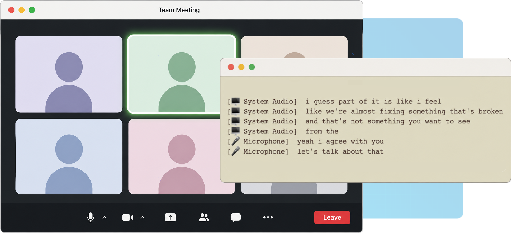

# ⑂ Splitstream

[](https://github.com/samuelokirby/splitstream/actions/workflows/ci.yml)
[](https://crates.io/crates/splitstream)
[](https://docs.rs/splitstream)
[](LICENSE)

<p align="center">
  
</p>

Realtime speech-to-text library for macOS and Windows, built for fast microphone and system audio transcription. Supports local model transcription and Deepgram. Perfect for meeting apps, note takers, or ambient computing.

## How it works

Splitstream records what you say and what you hear as two separate streams, then transcribes both.

How it grabs the system audio depends on the platform. On macOS it uses the Audio Tap API through Rust bindings from [cidre](https://crates.io/crates/cidre). On Windows it uses WASAPI loopback, which it reaches through [cpal](https://crates.io/crates/cpal) by opening the output device for input. Either way the engine above it is the same code.

Elementary echo cancellation powered by [SpeexDSP](https://github.com/xiph/speexdsp) keeps the mic channel clean even when audio is playing through speakers, at negligible performance cost.

The two channels stay apart the whole way through. Every transcript is tagged with the side it came from and how far into the stream it starts. You get two live transcripts at once, spread across threads, without blocking, on low-end machines.

#### 🤖 AI Disclaimer

*The crucial pieces of this library (core audio pipeline, audio capture, echo cancellation, transcription backend) were designed and written by a human. Docstrings and the refactoring that turned it into a usable library were made with Claude.*

## What you need

**Rust 1.85 or newer** on either platform. The crate is edition 2024. Anything that is not macOS or Windows is a `compile_error!`, since there is no portable way to record system audio.

### macOS

- **macOS 14.2 or newer.** `AudioHardwareCreateProcessTap`, the system-audio API, is marked `API_AVAILABLE(macos(14.2))`. Splitstream checks this while it runs and returns [`SplitStreamError::UnsupportedOsVersion`](#what-a-blocked-permission-looks-like-in-code) on older builds. The same number is public as `MIN_MACOS`.
- **Xcode Command Line Tools.** Run `xcode-select --install`.
- **cmake.** Run `brew install cmake`. The default build needs it, because echo cancellation builds SpeexDSP from source. The `deepgram` feature needs it too, for the Opus encoder. Only a build with [`aec` turned off](#feature-flags) and without `deepgram` skips cmake entirely.

### Windows

- **Windows 10 or newer.** This is the version splitstream is built and tested against. WASAPI loopback itself is older than that, so earlier releases may well work, but nothing checks the version at runtime and nothing is tested there.
- **The MSVC toolchain**, which `rustup` sets up by default with the `x86_64-pc-windows-msvc` target. The C parts of the build (SpeexDSP for echo cancellation, and Opus if you turn on `deepgram`) need it.
- **cmake** on `PATH`, for the same reason as on macOS. Get it from [cmake.org](https://cmake.org/download/) or run `winget install Kitware.CMake`.
- **LLVM**, because the echo canceller generates its Rust bindings with `bindgen`, and `bindgen` needs `libclang` at build time. Run `winget install LLVM.LLVM`. If the build still cannot find it, point it there with `setx LIBCLANG_PATH "C:\Program Files\LLVM\bin"`. macOS needs no separate step for this: `libclang` comes with the Command Line Tools.
- Nothing to sign and no permission to grant for system audio. See [Permissions](#permissions--signing).

> **On macOS you cannot skip the permissions.** macOS locks both the microphone and the system-audio tap behind TCC consent, and it gives that consent to a *signed bundle* rather than to a loose binary. Read [Permissions & Signing](#permissions--signing) before you decide splitstream is broken. On Windows there is nothing to grant for system audio and nothing to sign.

## Getting Started

### 🦜 Parakeet (local, free, fast)

Parakeet is the default backend. It needs no API key and no cloud. Everything runs on your own machine.

**Step 1.** Add splitstream to your project:

```bash
cargo add splitstream
```

**Step 2.** Download the model. This is a one-time step of about 481 MB across three files:

```bash
cargo install splitstream --features cli --bin download-parakeet
download-parakeet
```

The downloader pins one Hugging Face revision and checks every file against a SHA-256 checksum baked into the binary, so the bytes cannot change under you. It writes to the per-user app-data folder for your platform and prints the path it used: `~/Library/Application Support/splitstream/models/parakeet-eou` on macOS, `%LOCALAPPDATA%\splitstream\models\parakeet-eou` on Windows. Use `--dest DIR` or `$SPLITSTREAM_MODEL_DIR` to send it somewhere else.

`download-parakeet` is a helper for your own setup and nothing more. The library never calls it, and splitstream does not ship it to your users. All the crate wants is a folder holding the three files, so you can fetch them any way you like and point `.with_parakeet(path)` at the result. See [The model](#the-model) for what you are downloading and under which license.

**Step 3.** Use it in your Rust project:

```toml
# Cargo.toml
[dependencies]
splitstream = "0.2"
tokio = { version = "1", features = ["full"] }
```

```rust
use splitstream::{AudioSource, SplitStreamBuilder, SplitStreamError};

#[tokio::main]
async fn main() -> Result<(), SplitStreamError> {
    let (handle, mut transcripts) = SplitStreamBuilder::new()
        .with_parakeet("/path/from/download-parakeet")
        .echo_cancellation(true)
        .start()
        .await?;

    // The handle is `Clone` and every method takes `&self`, so a shutdown task
    // can hold one while you keep another for the mute controls.
    let stopper = handle.clone();
    tokio::spawn(async move {
        tokio::signal::ctrl_c().await.ok();
        stopper.shutdown();
    });

    while let Some(t) = transcripts.recv().await {
        let label = match t.source {
            AudioSource::Mic => "[🎤   Microphone]",
            AudioSource::Sys => "[🖥️ System Audio]",
            // `AudioSource` is `#[non_exhaustive]`.
            _ => "[?]",
        };
        println!("{label} {:>7.2}s  {}", t.start.as_secs_f32(), t.text);
    }
    Ok(())
}
```

The full version is in [`examples/parakeet.rs`](examples/parakeet.rs).

---

### ☁️ Deepgram (cloud, premium, blazing fast)

Deepgram is blazing fast. You'll need a [Deepgram API key](https://console.deepgram.com/) to use this feature.

> **Note:** the `deepgram` feature brings in Opus encoding, which needs cmake: `brew install cmake`

**Step 1.** Add splitstream with the `deepgram` feature:

```bash
cargo add splitstream --features deepgram
```

**Step 2.** Set your API key. Add it to `.env` or export it in your shell:

```
DEEPGRAM_API_KEY=your_key_here
```

**Step 3.** Use it in your Rust project:

```toml
# Cargo.toml
[dependencies]
splitstream = "0.2"
tokio = { version = "1", features = ["full"] }
```

```rust
use splitstream::{AudioSource, SplitStreamBuilder, SplitStreamError};

#[tokio::main]
async fn main() -> Result<(), SplitStreamError> {
    let api_key = std::env::var("DEEPGRAM_API_KEY").expect("DEEPGRAM_API_KEY not set");

    let (handle, mut transcripts) = SplitStreamBuilder::new()
        .with_deepgram(api_key)
        .echo_cancellation(true)
        .start()
        .await?;

    // A bad key or a dropped socket shows up here instead of as silence.
    if let Some(mut errors) = handle.errors() {
        tokio::spawn(async move {
            while let Some(e) = errors.recv().await {
                eprintln!("splitstream: {e}");
            }
        });
    }

    let stopper = handle.clone();
    tokio::spawn(async move {
        tokio::signal::ctrl_c().await.ok();
        stopper.shutdown();
    });

    while let Some(t) = transcripts.recv().await {
        if !t.is_final {
            continue; // partial result; a later one will take its place
        }
        let label = match t.source {
            AudioSource::Mic => "[🎤   Microphone]",
            AudioSource::Sys => "[🖥️ System Audio]",
            _ => "[?]",
        };
        println!("{label} {}", t.text);
    }
    Ok(())
}
```

The full version is in [`examples/deepgram.rs`](examples/deepgram.rs).

---

## Permissions & Signing

**This whole section is macOS.** It is about testing your app as you build it and signing it before you ship. Windows asks for none of it; skip to [Permissions on Windows](#permissions-on-windows) if that is all you need.

macOS has **two separate** privacy permissions. Each one has its own Info.plist key and its own TCC record.

| What | TCC service | Info.plist key | Prompt shows when |
|---|---|---|---|
| Microphone | `kTCCServiceMicrophone` | `NSMicrophoneUsageDescription` | the default input device opens, during `start()` |
| System audio | `kTCCServiceAudioCapture` | `NSAudioCaptureUsageDescription` | IO starts on the tap-backed aggregate device, during `start()` |

Two things catch almost everyone:

1. **The two permissions are separate.** Saying yes to "Microphone" does not hand over system audio. An app can have a working mic channel and never get a single sample of system audio.
2. **A missing `NSAudioCaptureUsageDescription` fails quietly.** You get no prompt and no error. Core Audio still hands back a tap, and the tap produces nothing. If system audio is silent, check this key first.

### Info.plist

```xml
<key>NSMicrophoneUsageDescription</key>
<string>Acme transcribes what you say during a meeting.</string>

<key>NSAudioCaptureUsageDescription</key>
<string>Acme transcribes the other side of your call.</string>

<key>LSMinimumSystemVersion</key>
<string>14.2</string>
```

Xcode does not offer `NSAudioCaptureUsageDescription` in its Info.plist dropdown. Type the key in by hand.

### Entitlements

```xml
<?xml version="1.0" encoding="UTF-8"?>
<!DOCTYPE plist PUBLIC "-//Apple//DTD PLIST 1.0//EN" "http://www.apple.com/DTDs/PropertyList-1.0.dtd">
<!-- Entitlements.plist -->
<plist version="1.0">
<dict>
  <key>com.apple.security.device.audio-input</key>
  <true/>

  <!-- Only if you sandbox (Mac App Store): -->
  <!-- <key>com.apple.security.app-sandbox</key><true/> -->

  <!-- Only if you use the Deepgram backend from a sandboxed app: -->
  <key>com.apple.security.network.client</key>
  <true/>
</dict>
</plist>
```

Sign with the hardened runtime (`codesign --options runtime --entitlements …`). That is what gives those entitlements any weight, and notarization asks for it.

### `cargo run` vs. a bundled `.app`

A binary from `cargo run` has no Info.plist and no lasting code-signing identity. Two things follow:

- It cannot carry the usage strings, so the system-audio prompt has no text to show.
- TCC hands the permission to the **responsible process**, which is your terminal. Whatever you allow lands on Terminal.app or iTerm rather than on your program.

For local work that is fine. Allow *Terminal* both permissions under **System Settings › Privacy & Security**, in the **Microphone** pane and the system-audio pane (recent releases call it "System Audio Recording Only"), and `cargo run` picks them up. Build a bundle for anything you ship, and for testing the real permission flow.

[`examples/bundled_app/`](examples/bundled_app) is a working, tested reference. It holds an `Info.plist`, an entitlements file, and a `build.sh` that wraps the `parakeet` example into a signed `.app`:

```bash
# ad-hoc signature, fine for a quick local test
./examples/bundled_app/build.sh --run

# a lasting identity, which is what you want, because TCC keys its record
# off the signing identity as well as the bundle id
SIGN_ID="Developer ID Application: Your Name (TEAMID)" \
BUNDLE_ID=com.yourco.app \
  ./examples/bundled_app/build.sh
```

Three traps worth naming:

- **Do not start `YourApp.app/Contents/MacOS/binary` from a shell.** The process falls back to your terminal as the responsible one and the grants land in the wrong place. Run `open "YourApp.app" --stdout /dev/stdout --stderr /dev/stderr` to keep the bundle identity and still see the output.
- **Ad-hoc (`-`) signing gives you a new identity on every build.** macOS reads each build as a new app and asks again. Move to a Developer ID certificate once that wears thin.
- **A bundle started from Finder has `/` as its working directory.** Model paths like `./models/parakeet-eou` will not be found. This is why `download-parakeet` writes to a full path under `~/Library/Application Support`.

### Clearing permissions while you build

`tccutil` wants the TCC service name without its `kTCCService` start:

```bash
tccutil reset Microphone   com.yourco.app
tccutil reset AudioCapture com.yourco.app
tccutil reset All          com.yourco.app
```

The next launch starts from a clean slate. If you leave out the bundle id, you clear that permission for *every* app on the machine, which is seldom what you want.

### What a blocked permission looks like in code

The two channels fail in different ways on purpose. Losing the microphone leaves the session running with one side. Losing the system-audio tap ends it.

| Situation | What you get |
|---|---|
| System audio blocked | `start()` returns `Err(SplitStreamError::PermissionDenied { what: PermissionKind::SystemAudioCapture })`. Splitstream knows Core Audio's `kAudioHardwareIllegalOperationError` (`'nope'`, 1852796517) and turns it into this error. |
| Any other Core Audio tap failure | `Err(SplitStreamError::TapCreationFailed { stage, status })`. It carries the setup step that failed and the raw `OSStatus`. |
| macOS older than 14.2 | `Err(SplitStreamError::UnsupportedOsVersion { found })`, returned before Core Audio is touched. |
| Microphone blocked | **The session keeps running** on system audio alone. `start()` returns `Ok`, and `SplitStreamError::PermissionDenied { what: PermissionKind::Microphone }` is logged at `warn` and sent to `handle.errors()`. Splitstream reads the TCC status straight from `AVCaptureDevice`, because cpal cannot tell you this: with the mic blocked, building and playing the stream *works*, and the callback just gets silence forever. |
| Microphone missing or unusable | **The session keeps running**, as above. You get `SplitStreamError::NoMicDevice` when there is no default input device, or `MicCaptureFailed { stage, source }` when cpal turns down the device or the stream. Call `.mic_muted(true)` on the builder if you meant to run without a mic. |
| `NSAudioCaptureUsageDescription` missing from the bundle | **No error at all.** The tap is built and gives you silence. This is the one failure the crate cannot catch for you. |

For the **system-audio tap**, "not asked yet" and "blocked" look the same to your program. Core Audio hands back the same `'nope'` status either way, and only the user can tell them apart in System Settings. For the **microphone** you can tell them apart. Splitstream reads `NotDetermined` as "not blocked" so the system prompt can still show, and only a real no from the user, or an MDM rule, becomes `PermissionDenied`.

```rust
// Catch failures that happen while you run — mic permission trouble, or a
// backend that dies later — instead of staring at an empty transcript stream.
if let Some(mut errors) = handle.errors() {
    tokio::spawn(async move {
        while let Some(e) = errors.recv().await {
            eprintln!("splitstream: {e}");
        }
    });
}
```

### Permissions on Windows

There is nothing to sign and nothing to grant for system audio. WASAPI loopback is not gated, so recording the speakers needs no consent and raises no prompt. `start()` therefore never returns `PermissionDenied { SystemAudioCapture }` on Windows.

The **microphone** is gated, under **Settings › Privacy & security › Microphone**. Two things follow:

1. **A refusal looks like a capture failure, not a permission error.** Windows gives no status to read ahead of time, so splitstream cannot report `PermissionDenied { Microphone }` the way it does on macOS. You get `MicCaptureFailed { stage, source }` carrying the underlying cpal error instead. The session keeps running on system audio alone, exactly as it does for a refused mic on macOS.
2. **Check "Let desktop apps access your microphone"** as well as the top-level toggle. The two are separate, and the second one is what governs a Rust binary.

Everything else — the error channel, the mute controls, the no-mic fallback — behaves identically on both platforms.

---

## The model

The `parakeet` backend runs **NVIDIA Parakeet-Realtime-EOU-120m-v1**. It is a 120M-parameter cache-aware streaming FastConformer-RNNT that also marks the end of each utterance. English only, no punctuation or capital letters, 80–160 ms latency.

| | |
|---|---|
| Upstream weights | [`nvidia/parakeet_realtime_eou_120m-v1`](https://huggingface.co/nvidia/parakeet_realtime_eou_120m-v1) |
| ONNX export splitstream downloads | [`altunenes/parakeet-rs`](https://huggingface.co/altunenes/parakeet-rs), folder `realtime_eou_120m-v1-onnx`, pinned to revision `a61d2818` |
| Files | `encoder.onnx` (459.3 MB), `decoder_joint.onnx` (21.3 MB), `tokenizer.json` (20 KB) |
| Whole download | about 481 MB (458 MiB on disk) |
| Weights license | [NVIDIA Open Model License](https://www.nvidia.com/en-us/agreements/enterprise-software/nvidia-open-model-license/). NVIDIA says the model is "ready for commercial/non-commercial use" |

The encoder is big for its parameter count because it ships at fp32. Parameter count and file size measure two different things.

**The license on the weights is not the license on this crate.** Splitstream is MIT. The model you download falls under the NVIDIA Open Model License, and the ONNX export is a third-party copy of NVIDIA's weights. Read that license before you ship the model inside a product. If your legal team needs you to, keep your own copy of the files and point `download-parakeet --dest` or `.with_parakeet(path)` at it. Nothing in the crate reaches for Hugging Face while it runs.

---

## Mid-stream controls

The handle you get from `.start()` is `Clone`, and every method takes `&self`. You can hand copies to a UI thread, a hotkey handler, and a shutdown task at the same time:

```rust
handle.set_mic_muted(true);          // silence the mic channel
handle.set_sys_muted(true);          // silence system audio (compliance mode)
handle.set_echo_cancellation(false); // switch AEC on or off while running
handle.shutdown();                   // stop everything cleanly
```

There are getters to match: `mic_muted()`, `sys_muted()`, and `echo_cancellation()`. All of these land on the next 20 ms tick and none of them block.

Dropping the last handle also shuts the session down, so a handle that goes out of scope never leaves the audio tap running behind you.

`TranscriptStream` is a bounded channel that **drops the oldest** entry first. A reader that falls behind loses the oldest waiting transcripts rather than eating memory without end. `transcripts.dropped()` tells you how many were lost, `.resubscribe()` gives another reader its own view, and the stream implements `futures_core::Stream`, so it works with the rest of the async world. Set the size with `.channel_capacity(n)`; the default is `DEFAULT_CHANNEL_CAPACITY`.

---

## Transcription Support

| Backend | Method | Feature flag | Notes |
|---|---|---|---|
| **Parakeet** | `.with_parakeet(model_dir)` | `parakeet` *(default)* | Local ONNX, no API key, no network |
| **Deepgram** | `.with_deepgram(api_key)` | `deepgram` | Cloud, needs an API key and cmake |

To use Deepgram on its own, which skips building Parakeet and ONNX Runtime:

```toml
splitstream = { version = "0.2", default-features = false, features = ["deepgram"] }
```

### Feature flags

| Flag | Default | What it turns on |
|---|---|---|
| `parakeet` | ✅ on | Parakeet ONNX inference (brings in ORT and ONNX Runtime) |
| `aec` | ✅ on | Echo cancellation (Speex, through `aec-rs`). The one default dependency that needs cmake and a C toolchain. Same on both platforms |
| `deepgram` | ❌ off | Deepgram cloud backend (brings in Opus, needs cmake) |
| `cli` | ❌ off | The bundled `splitstream` demo binary and the `download-parakeet` downloader, with the dependencies only they need (`colored`, `config`, `dotenvy`, `reqwest`, `sha2`) |

Turning `aec` off drops the one default dependency that needs cmake. Set `default-features = false` and switch your backend back on. It costs you something real: the mic then hears whatever the speakers play, so on a call the far end lands in the transcript twice, once from the system tap and once bleeding into the mic. Leave it on unless you feed splitstream audio that is already split, or you cancel the echo yourself. With the feature off, `echo_cancellation(true)` and `set_echo_cancellation(true)` still work and still report their state. They just have nothing to switch on.

Library users never need `cli`. It is there so that adding splitstream as a dependency does not drag an HTTP stack and a config parser into your build:

```bash
cargo install splitstream --features cli --bin download-parakeet
cargo install splitstream --features cli --bin splitstream
```

---

## Logging

Splitstream never prints. Everything goes through the [`log`](https://docs.rs/log) crate, so you see nothing until you install a subscriber:

```toml
[dependencies]
env_logger = "0.11"
```

```rust
env_logger::init(); // then: RUST_LOG=splitstream=info cargo run
```

`tracing-subscriber` works just as well through `tracing`'s `log` support. Filters worth knowing:

| Filter | What you see |
|---|---|
| `RUST_LOG=splitstream=info` | which devices were picked, sample rates, backend start and stop |
| `RUST_LOG=splitstream=warn` | dropped-audio counts, AEC failures, sessions running without a mic |
| `RUST_LOG=splitstream=debug` | audio detail on every tick, which is noisy |
| `RUST_LOG=splitstream::audio=debug` | capture and resampling only |

Errors that happen while you run are logged at `error` *and* sent to `handle.errors()`. The log is never your only warning.

---

## The demo binary

Run `cargo install splitstream --features cli --bin splitstream`, or `cargo run --features cli` in a checkout. Either builds a terminal demo that reads `settings.toml` from the working directory:

```toml
compliance_mode_on_start = false     # start with sys audio muted
echo_cancellation = true
transcription_backend = "parakeet"   # "parakeet" | "deepgram"

parakeet_model_dir = "./models/parakeet-eou"
```

Deepgram reads `DEEPGRAM_API_KEY` from the environment or a `.env` file. There is no API-key setting in `settings.toml` on purpose, since keys do not belong in a config file you commit.

This file sets up the demo binary and nothing else. As a library, you set everything through `SplitStreamBuilder`.

---

## License

Splitstream uses the [MIT License](LICENSE). Copyright (c) 2026 Sam Kirby.

**Can I use this in a paid, closed-source product?** Yes. MIT asks only that you keep the copyright notice and the license text.

**Do I have to open-source my app?** No. Splitstream was AGPL-3.0 from 0.1.2 through 0.1.9. That requirement is gone as of 0.2.0, and there is no longer a commercial license to buy.

**What about the model weights?** That is a separate question with a separate license. See [The model](#the-model). The MIT license covers this crate's source code, not the NVIDIA weights the `parakeet` backend loads.
